# report-ppt-workflow · Report PPT Workflow


> 🌏 **中文版: [README.md](./README.md)**

A full-pipeline agent skill that turns a pile of messy source materials into a professional report PPT: material organizing → outline → official-document writing → layout. Built for formal reporting scenarios (government / state-owned enterprise / corporate), methodology distilled from [this video](https://www.bilibili.com/video/BV1kLWu64EN3/) (Chinese).

## Quick Start

```bash
npx skills add Coder-Lowic/report-ppt-workflow
```

Or just send this to any AI agent with shell access:

```text
Install report-ppt-workflow for me: run npx skills add https://github.com/Coder-Lowic/report-ppt-workflow
```

Already installed? Re-run the same `npx skills add` command to update.

Then say:

```text
Turn this work summary, these spreadsheets and photos into a quarterly report PPT for my director, 10 minutes, use our official template (pptx attached).
```

## Best for / Not for

**Best for**
- Formal work reports (annual / quarterly / project reviews) where restraint and rigor matter
- Messy materials that need structure-first: logic → outline → copy → slides
- Template/typography constraints imposed by your organization

**Not for**
- Poster-grade creative HTML decks (see [guizang-ppt-skill](https://github.com/op7418/guizang-ppt-skill))
- Single-page posters with no reporting logic

## Workflow


🎬 **Interactive version**(zoom/search/export):[coder-lowic.github.io/report-ppt-workflow](https://coder-lowic.github.io/report-ppt-workflow/)

## Architecture



🎬 [Interactive](https://coder-lowic.github.io/report-ppt-workflow/architecture.html)


## Dependencies (auto tier by environment)

| Tier | Requirement | Capabilities |
|---|---|---|
| Basic | none | full content workflow + layout advice + review checklist |
| Standard | `pip install python-pptx pillow` | + template extraction / editable-PPT generation / speaker notes / structural verification |
| Full | `pip install pptx-designer` | + bundled PPT-Design workflow (Build/FreeStyle/VI Build) + OCR number reconciliation |

Offline engine (if PyPI unreachable), run from the repo root: `pip install skills/report-ppt-workflow/bundled/vendor/pptx_designer-1.0.0b11-py3-none-any.whl`

## License

- MIT for this repository, see [LICENSE](LICENSE); third-party components in [THIRD_PARTY_NOTICES.md](THIRD_PARTY_NOTICES.md)
- `bundled/` contains [sunchaokun/PPT-Design-Skill](https://github.com/sunchaokun/PPT-Design-Skill) and `pptx-designer` (both MIT)
